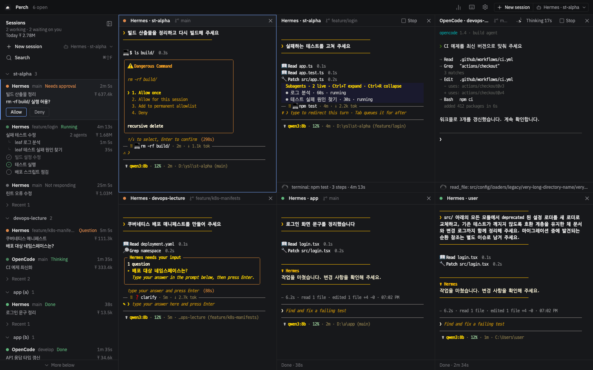
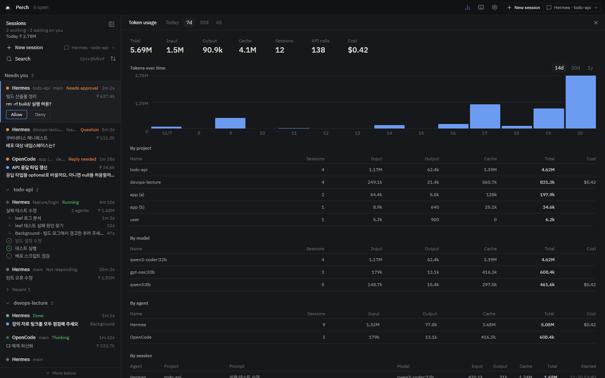

# Perch


CLI 코딩 에이전트(Hermes, OpenCode)를 여러 개 띄워 한 화면에서 지켜보는 가벼운 데스크톱 앱이다. 세션은 분할 터미널로 띄우고, 옆 패널에서 모든 세션 상태를 한눈에 본다. 이름은 높은 곳에서 전체를 내려다보는 자리인 횃대(perch)에서 따왔다.

Hermes GUI는 창을 여러 개 띄우면 느려지고 버그가 많았다. 그래서 에이전트는 CLI 그대로 쓰고, 여러 세션을 띄우고 지켜보는 일만 이 앱이 맡는다. 칸이 늘어도 느려지지 않는 것이 목표다.

<br clear="left" />





## 현재 상태

Hermes 연결까지 동작한다. 분할 터미널에서 Hermes, OpenCode, 셸을 실행하고, 패널에서 Hermes 세션의 상태·제목·토큰을 본다.

| 단계 | 내용 | 상태 |
|---|---|---|
| 1 | UI 시제품 | 완료 |
| 2 | Tauri 셸 + 실제 터미널, 여러 창 | 완료 |
| 3 | Hermes 연결 (상태 표시, resume, 토큰 사용량) | 완료. 패널의 승인 버튼은 실제 승인 화면으로 확인하지 못했다 |
| 4 | OpenCode 연결 | 보류. 칸에서 실행은 되고 상태 표시는 없다 ([붙이는 방법](docs/ADAPTERS.md)) |
| 5 | 오프라인 Windows 10 설치 검증 | 설치 파일은 만들어진다. 깨끗한 PC에서의 검증은 아직 |

## 설치

[Releases](https://github.com/Isaac-Lee/Perch/releases)에서 설치 파일을 받는다.

| OS | 파일 | 참고 |
|---|---|---|
| Windows 10/11 (x64) | `Perch_<버전>_x64-setup.exe` | 관리자 권한 없이 사용자별로 설치한다. WebView2 오프라인 설치본이 들어 있어 인터넷 없이 설치된다 (약 216MB) |
| macOS (Apple Silicon) | `Perch_<버전>_aarch64.dmg` | Intel 맥용은 아직 없다 |

설치 파일에 코드 서명이 없다.
- Windows: SmartScreen 경고가 나오면 "추가 정보 → 실행"을 누른다.
- macOS: 처음 실행할 때 막히면 시스템 설정 → 개인정보 보호 및 보안에서 "확인 없이 열기"를 누른다.

### Hermes 연결

1. Perch의 설정(톱니바퀴) → Hermes → **Connect**를 누른다. Hermes의 `config.yaml`에 훅 블록이 추가되고, 원본은 `config.yaml.perch-backup`으로 남는다.
2. 이어서 나오는 **Restart gateway**를 누른다. Hermes gateway는 시작할 때만 훅을 읽는다. 실행 중인 Hermes 작업은 중단된다.
3. New session으로 Hermes를 연다.

되돌리려면 같은 자리의 Disconnect를 누른다. 훅은 Hermes를 막지 않는다. 훅 파일이 없거나 실패해도 Hermes는 그대로 동작한다.

## 소스에서 실행

```bash
git clone https://github.com/Isaac-Lee/Perch.git
cd Perch/desk
npm install
npm run dev          # 브라우저에서 가짜 데이터로 화면만 본다 (http://localhost:5173)
npm run tauri dev    # 앱 창. 실제 터미널
npm run tauri build  # 설치 파일
npm test
```

Node 20 이상이 필요하다. 앱 창과 빌드에는 Rust와 OS별 빌드 도구(Windows: VS Build Tools C++, macOS: Xcode Command Line Tools)가 필요하다. 설치 파일은 GitHub Actions(`.github/workflows/build.yml`)가 두 OS용으로 만든다.

## 화면 구성

**세션 패널 (Sessions)**
- 모든 세션을 작업 디렉토리(git 저장소)별로 묶어 보여준다. 묶음은 접을 수 있다.
- 세션마다 상태(`Working`, `Thinking`, `Running`, `Needs approval`, `Question`, `Waiting`), 경과시간, git 브랜치, 토큰 수, 서브에이전트, todo가 표시된다.
- 세션을 클릭하면 그 세션으로 이동한다. 닫힌 세션이면 새로 연다.
- 승인 요청은 [Allow] / [Deny]로 바로 처리한다.
- 패널 폭은 경계를 끌어서 조절한다.

**세션 격자**
- 세션 수에 따라 자동으로 격자가 바뀐다. 개수 제한은 없다.
- [+]는 기본 에이전트와 폴더로 바로 세션을 연다.
- 세션마다 헤더(에이전트, 폴더, 브랜치, 상태 점, `Thinking` 표시, [Stop])와 하단 진행 줄(지금 하는 일 · 단계 수 · 경과시간)이 있다.
- 승인·질문 내용, 입력창, 모델 표시는 에이전트의 자체 터미널 화면에 맡긴다.

**토큰 사용량 (Token usage)**
- 기간별 합계, 토큰 추이 차트(`14d` / `30d` / `1y`, `1y`는 `Daily` / `Weekly`), 프로젝트·모델·에이전트·세션별 표를 보여준다.
- 가격표는 넣지 않았다. 비용은 에이전트가 기록한 값이 있을 때만 표시한다.

**설정 (Settings)**
- 터미널 글꼴과 크기, 새 세션의 기본 에이전트와 폴더를 바꿀 수 있다.

## 문서

| 문서 | 내용 |
|---|---|
| [docs/HANDOFF.md](docs/HANDOFF.md) | 이어서 작업할 때 먼저 읽는 문서. 현재 상태, 결정 사항, 지킬 규칙, 다음 할 일 |
| [설계 문서](docs/superpowers/specs/2026-11-17-perch-design.md) | 전체 5단계의 설계 |
| [1단계 계획](docs/superpowers/plans/2026-11-17-perch-ui-prototype.md) | UI 시제품 계획과 검토 반영 기록 |
| [desk/HERMES_UI_NOTES.md](desk/HERMES_UI_NOTES.md) | Hermes CLI가 자체적으로 그리는 화면 요소 정리 |

`prototype/`에는 초기에 만든 Hermes용 CLI 대시보드(`dash.py`)가 있다. 3단계에서 훅 로직을 옮길 때 참고하는 용도다.

## 사용한 것

| 이름 | 용도 | 라이선스 |
|---|---|---|
| [thinking-orbs](https://libraries.dev/) | 생각 중·진행 표시 | MIT |
| [unslop](https://github.com/heydamir/unslop) (Damir Sokolovsky) | 디자인 규칙 | CC BY 4.0 |
| [codeburn](https://github.com/getagentseal/codeburn) | 토큰 사용량 읽는 방식 참고 (코드는 새로 작성) | MIT |
| IBM Plex Sans, IBM Plex Sans KR | UI 글꼴 | SIL OFL 1.1 |
| [D2Coding](https://github.com/naver/d2-coding-font), [Monoplex KR](https://github.com/y-kim/monoplex) | 터미널 글꼴 | SIL OFL 1.1 |
| xterm.js, lucide | 터미널, 아이콘 | MIT, ISC |
