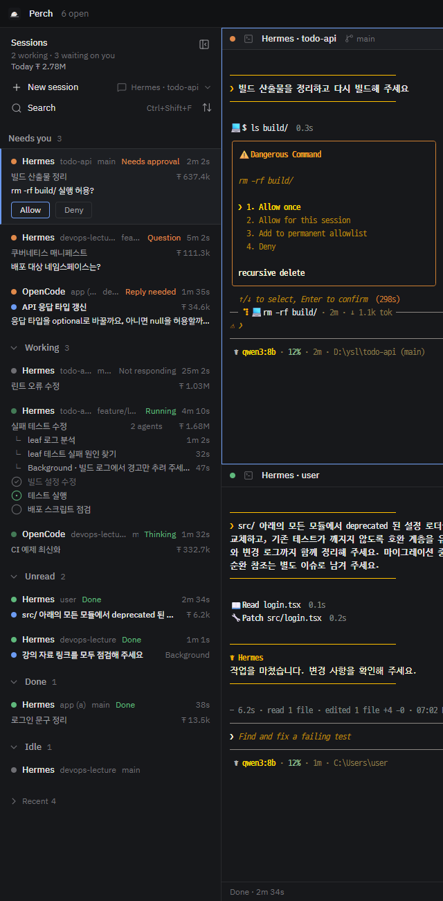
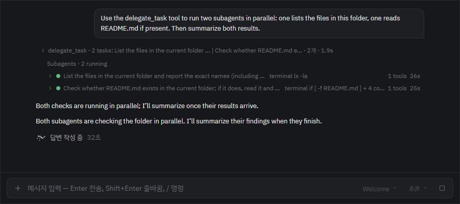

# Perch


Perch는 CLI 코딩 에이전트(Hermes, OpenCode)를 여러 개 띄워 놓고 한 화면에서 지켜보는 가벼운 데스크톱 앱이다. 세션은 분할된 칸에 띄우고, 옆 패널에서 모든 세션의 상태를 한눈에 본다. 이름은 높은 곳에서 전체를 내려다보는 자리인 횃대(perch)에서 따왔다.

에이전트는 CLI 그대로 쓰고, 여러 세션을 띄우고 지켜보는 일만 Perch가 맡는다. 칸이 늘어도 느려지지 않는 것이 목표다. 실행 중에는 네트워크에 접속하지 않아서 오프라인 PC에서도 쓸 수 있다.

<br clear="left" />


## 설치

[Releases](https://github.com/Isaac-Lee/Perch/releases/latest)에서 설치 파일을 받는다.

| OS | 파일 | 참고 |
|---|---|---|
| Windows 10/11 (x64) | `Perch_<버전>_x64-setup.exe` | 관리자 권한 없이 사용자별로 설치한다. WebView2 오프라인 설치본이 들어 있어 인터넷 없이 설치된다 |
| macOS (Apple Silicon) | `Perch_<버전>_aarch64.dmg` | Intel 맥용은 아직 없다 |

설치 파일에는 코드 서명이 없다.
- Windows: SmartScreen 경고가 나오면 "추가 정보 → 실행"을 누른다.
- macOS: 처음 실행할 때 막히면 시스템 설정 → 개인정보 보호 및 보안에서 "확인 없이 열기"를 누른다.

### Hermes 연결

1. Perch 설정(톱니바퀴) → Hermes → **Connect**를 누른다. Hermes의 `config.yaml`에 훅 블록이 추가되고, 원본은 `config.yaml.perch-backup`으로 남는다.
2. 이어서 나오는 **Restart gateway**를 누른다. Hermes gateway는 시작할 때만 훅을 읽는다. 실행 중인 Hermes 작업은 중단된다.
3. **New session**으로 Hermes를 연다.

되돌리려면 같은 자리의 **Disconnect**를 누른다. 훅은 Hermes를 막지 않는다. 훅 파일이 없거나 실패해도 Hermes는 그대로 동작한다.

## 기능

**세션 패널**
- 승인 요청, 질문, 답을 기다리는 세션을 맨 위 **Needs you**에 모은다. 승인은 [Allow] / [Deny]로 바로 처리한다.
- 세션마다 상태, 걸린 시간, git 브랜치, 토큰 수, 서브에이전트, todo가 보인다.
- 아직 보지 않은 결과에는 파란 점이 붙는다.
- 폴더별 또는 상태별로 묶고, 끌어서 순서를 바꾸고, 제목·폴더·브랜치로 검색한다.



**칸 격자**
- 세션 수에 따라 격자가 바뀌고 개수 제한은 없다. 칸 머리줄을 끌어 배치를 바꾸면 배치가 저장된다. 앱을 다시 열면 열려 있던 칸이 같은 배치로 돌아온다(첫 창만). Hermes 칸은 같은 대화를 잇고, 셸과 OpenCode 칸은 같은 폴더에서 새로 열린다.
- 칸마다 상태와 진행 줄(지금 하는 일, 단계 수, 경과 시간)이 있다.
- Hermes는 채팅 보기와 터미널(TUI) 중에서 고른다. OpenCode와 셸은 터미널 칸으로 연다. 상태 표시는 아직 Hermes만 된다.
- 단축키는 `Ctrl+Shift` 조합, `Ctrl+Tab`, `Ctrl+1~9`만 써서 터미널 입력과 겹치지 않는다.

**Hermes 채팅 보기**
- 답변은 마크다운으로 그리고 코드 블록은 구문 강조한다. 도구 호출은 한 줄로 접히고, 누르면 인자와 결과가 펼쳐진다.
- 승인과 질문은 칸 안의 버튼으로 답한다.
- 이미지 첨부, 모델과 추론 강도 선택, `/` 슬래시 명령, `↑` / `↓` 입력 기록을 지원한다.
- 작업 중에 보낸 메시지는 대기 카드로 뜨고, "지금 보내기"로 실행 중인 작업에 바로 넘길 수 있다.
- 내 메시지에서 **되감기**, **편집**, **포크**를 한다. 포크는 그 지점까지의 대화를 새 칸으로 연다.
- 칸을 닫아도 Hermes 작업은 계속 돈다. 같은 세션을 다시 열면 이어서 본다.

**서브에이전트와 백그라운드 작업**
- `delegate_task`로 띄운 서브에이전트가 목표, 지금 쓰는 도구, 경과 시간과 함께 트리로 보인다.
- 칸 머리줄의 그래프 버튼을 누르면 서브에이전트와 백그라운드 작업이 그래프로 열린다. 끝난 작업은 숨기거나 다시 볼 수 있다.
- `/background`로 띄운 작업은 부모 세션 아래 한 줄로 보이고, 눌러서 결과를 본다.



**토큰 사용량**
- 기간별 합계와 추이 차트, 프로젝트·모델·에이전트·세션별 표를 보여준다.
- 가격표는 넣지 않았다. 비용은 에이전트가 기록한 값이 있을 때만 표시한다.


**설정**
- 테마(Light, Dark, Midnight, Black), 터미널 글꼴과 크기, 새 세션의 기본 에이전트와 폴더를 고른다. Restore를 끄면 앱을 열 때 빈 격자로 시작한다. 창을 여러 개 열어도 보관, 읽음, 순서 설정은 서로 덮어쓰지 않고 합쳐진다.

## 기여하기

버그 제보, 기능 제안, PR 모두 환영한다.

- 버그와 제안은 [Issues](https://github.com/Isaac-Lee/Perch/issues/new/choose)에서 템플릿을 골라 올린다.
- PR은 `main`을 대상으로 연다. PR 템플릿의 확인 항목을 채운다.
- 화면에 보이는 동작을 바꾸면 이 README의 기능 설명도 같은 PR에서 고친다.

### 소스에서 실행

```bash
git clone https://github.com/Isaac-Lee/Perch.git
cd Perch/desk
npm install
npm run dev          # 브라우저에서 가짜 데이터로 화면만 본다 (http://localhost:5173)
npm run tauri dev    # 앱 창과 실제 터미널
npm test
npm run lint
npm run tauri build  # 설치 파일
```

Node 22.12 이상이 필요하다 (CI는 24). 앱 창과 빌드에는 Rust와 OS별 빌드 도구(Windows: VS Build Tools C++, macOS: Xcode Command Line Tools)가 필요하다. PR을 열면 GitHub Actions가 Windows와 macOS 설치 파일을 빌드한다.

### 지켜야 할 것

- 에이전트 훅은 어떤 경우에도 에이전트 작업을 막으면 안 된다. 항상 exit 0으로 끝내고 stdout에는 아무것도 쓰지 않는다.
- 실행 중에는 네트워크에 접속하지 않는다. 자동 업데이트, 텔레메트리, CDN 글꼴을 쓰지 않는다.
- 디자인은 [unslop](https://github.com/heydamir/unslop) 규칙을 따른다. 중립 회색에 강조색 하나만 쓰고, 그라데이션·글로우·이모지 아이콘은 쓰지 않는다.
- 다른 에이전트를 붙이는 방법은 [docs/ADAPTERS.md](docs/ADAPTERS.md), 버전 규칙은 [docs/VERSIONING.md](docs/VERSIONING.md)에 있다.

## 사용한 것

| 이름 | 용도 | 라이선스 |
|---|---|---|
| [thinking-orbs](https://libraries.dev/) | 생각 중·진행 표시 | MIT |
| [unslop](https://github.com/heydamir/unslop) (Damir Sokolovsky) | 디자인 규칙 | CC BY 4.0 |
| [codeburn](https://github.com/getagentseal/codeburn) | 토큰 사용량 읽는 방식 참고 (코드는 새로 작성) | MIT |
| IBM Plex Sans, IBM Plex Sans KR | UI 글꼴 | SIL OFL 1.1 |
| [D2Coding](https://github.com/naver/d2-coding-font), [Monoplex KR](https://github.com/y-kim/monoplex) | 터미널 글꼴 | SIL OFL 1.1 |
| xterm.js, lucide | 터미널, 아이콘 | MIT, ISC |
| [Hermes Agent](https://github.com/NousResearch/hermes-agent) | 채팅 보기의 gateway 클라이언트가 Hermes의 wire 규약(hermes-gateway-v1)을 따른다 (코드는 새로 작성) | MIT |

## 라이선스

[MIT + Commons Clause](LICENSE).
- 개인과 회사가 무료로 쓰고, 고치고, 내부에 배포할 수 있다. 회사 업무에 써도 된다.
- Perch 자체나 Perch가 주된 가치인 제품·서비스(호스팅, 유료 지원 포함)를 돈을 받고 파는 것은 안 된다.
- 포함된 글꼴(`desk/public/fonts/`)과 의존 라이브러리는 각자의 라이선스를 따른다.
